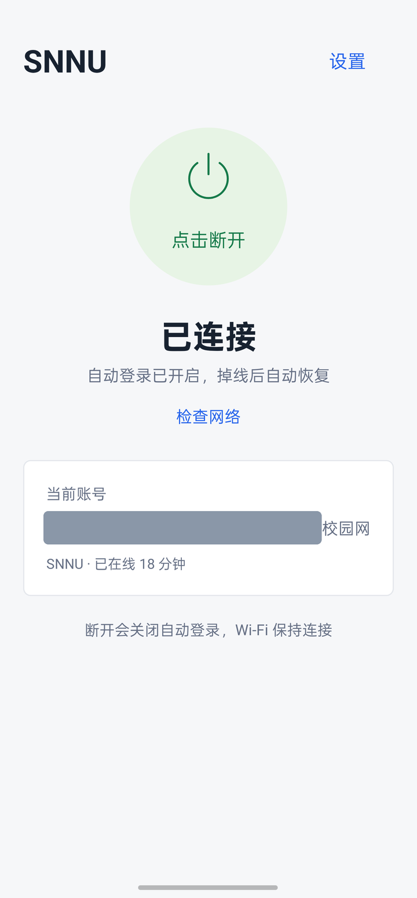
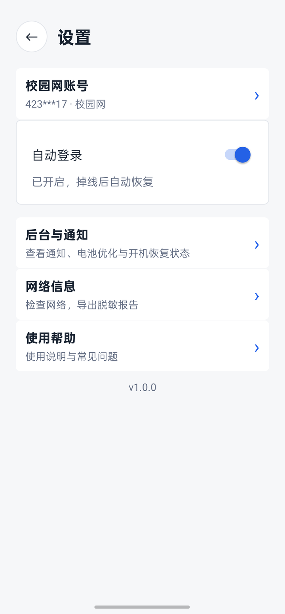
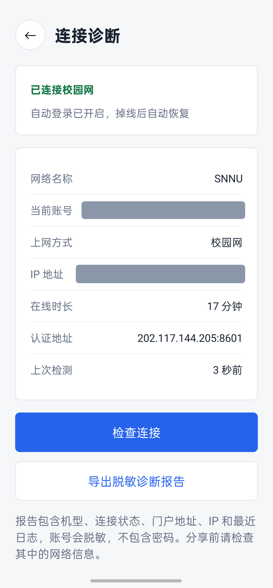
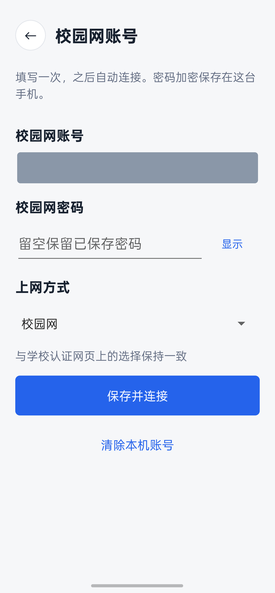
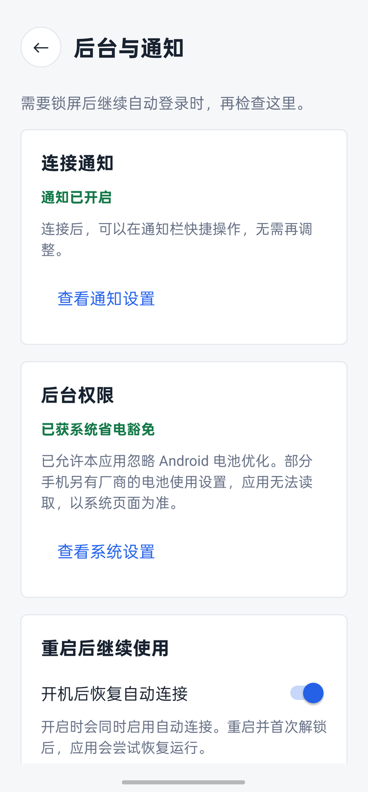
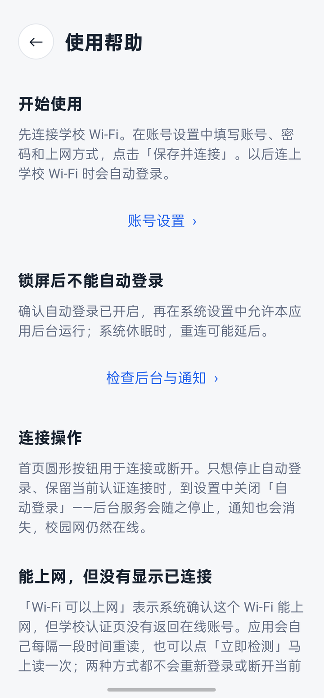
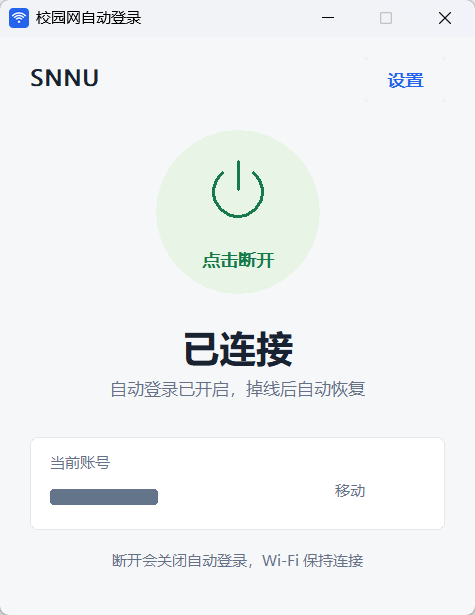
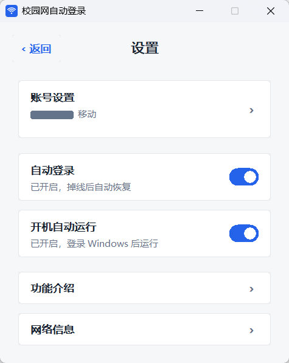
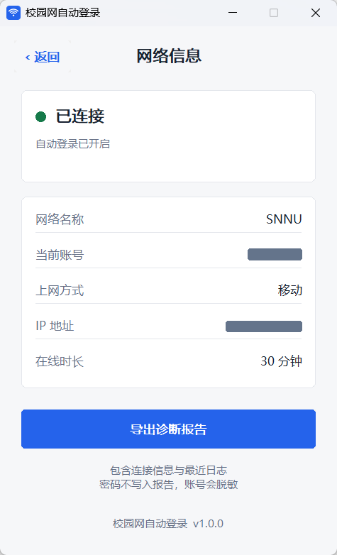
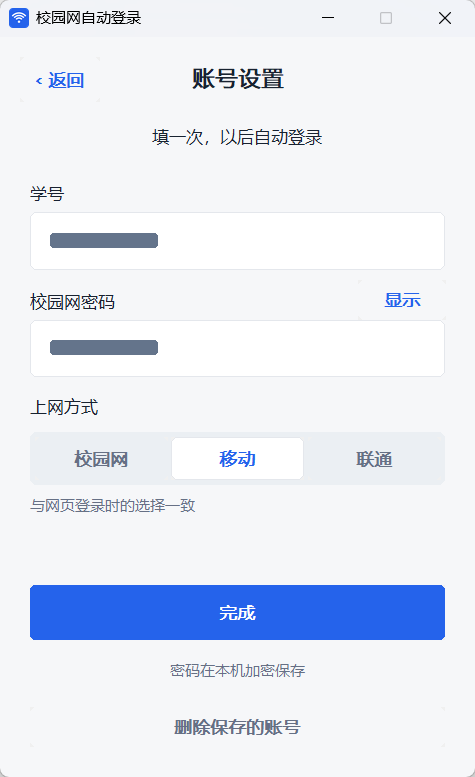

# SNNU 校园网自动登录

连接学校网络，剩下的交给它。

陕西师范大学 Dr.COM 校园网的一键认证工具。Windows、macOS、Android 三个原生客户端，同一套行为：自动登录、掉线重连、假在线修复，密码只在本机加密保存。

[](#windows)
[](docs/macos.md)
[](android/README.md)
[](LICENSE)
[](https://github.com/shixiang-liu/SNNU-AutoLogin/releases)

| 平台 | 版本 | 形态 | 具体要求 |
| --- | --- | --- | --- |
| Windows | 1.0.1 | 免安装绿色版，约 1 MB 单文件 | Windows 10 / 11 x64 |
| Android | 1.0.0 | 独立 APK，正式签名 | Android 8.0 及以上 |
| macOS | 测试版 | 原生应用 | macOS 13+（Apple Silicon / Intel） |

三个客户端各自保存账号，互不迁移；Windows 的 DPAPI 密码不能导到 Android 的 Keystore。

## 界面预览

Android 与 Windows 均为真机截图，学号、密码区域和 IP 已用不透明色块遮盖。

### Android

| 主页 | 设置 | 连接诊断 |
| --- | --- | --- |
|  |  |  |

<details>
<summary>账号设置、后台与通知、使用帮助</summary>

| 账号设置 | 后台与通知 | 使用帮助 |
| --- | --- | --- |
|  |  |  |

</details>

### Windows

| 主页 | 设置 |
| --- | --- |
|  |  |

<details>
<summary>功能介绍、网络信息与账号设置</summary>

| 功能介绍 | 网络信息 |
| --- | --- |
|  |  |



</details>

macOS 界面与 Windows 一致，构建方式见 [macOS 说明](docs/macos.md)。

## 能做什么

| 功能 | 说明 |
| --- | --- |
| 自动登录 | 连上学校网络后自动完成认证，不需要每次打开网页 |
| 掉线重连 | 网络变化、休眠唤醒、系统限流后重新认证 |
| 假在线修复 | 门户显示在线但外网不通时，确认本人会话后才重新登录，不覆盖别人的登录 |
| 失败处理 | 密码错误、欠费、验证码、设备数超限分别归类；异常时暂缓提交，避免把账号试锁 |
| 认证地址发现 | 门户地址变化时自动重新识别，陌生地址需用户确认后才提交密码 |
| 密码加密 | Windows 用 DPAPI、Android 用 Keystore、macOS 用钥匙串，明文不落盘 |
| 诊断导出 | 账号脱敏的连接信息与最近日志，方便反馈问题 |
| 轻量 | Windows 约 1 MB 单文件；Android 约 55 KB，没有常驻第三方运行时 |

## 下载与安装

从 [Releases](https://github.com/shixiang-liu/SNNU-AutoLogin/releases) 下载对应平台的文件。

### Windows

1. 解压到固定位置，双击「校园网自动登录.exe」
2. 填写学号、校园网密码和上网方式，点击「保存并连接」
3. 关闭窗口后程序在托盘继续运行

### Android

1. 安装 `SNNU-AutoLogin-android.apk`，按提示允许通知
2. 连接学校 Wi-Fi，填写账号、密码和上网方式，点击「保存并连接」
3. 之后连上学校 Wi-Fi 会自动认证；关闭「自动登录」即停止后台并保留当前连接

详细说明见 [Android 说明](android/README.md) 与 [验证记录](android/VALIDATION.md)。

### macOS

见 [macOS 说明](docs/macos.md)。

## 项目结构

```text
src/                Windows 与 macOS 共用的 Rust 代码
  main.rs           按平台选择原生程序入口
  win32_main.rs     Windows 命令行与诊断导出
  macos/            macOS 原生窗口、菜单栏、钥匙串与系统适配
  desktop_ui.rs     原生 Win32 界面与交互
  ui_model.rs       状态文案与主要操作
  network.rs        Windows Wi-Fi 和有线网络信息
  portal.rs         门户探测、认证、地址发现与错误归类
  agent.rs          后台巡检、重连、保活和控制接口
  config.rs         配置、DPAPI 加密与原子写入
  process_lock.rs   跨进程互斥
  autostart.rs      当前用户的开机运行设置
  notification.rs   通知状态与过期控制
  tray.rs           Windows 托盘与快捷操作
  tray_model.rs     托盘事件与菜单模型
android/            Android 客户端（Java，原生控件，无第三方运行时）
  app/src/main/     界面、前台服务、门户协议与本地存储
  app/src/test/     协议、状态、调度与脱敏的离线测试
  app/src/androidTest/ 设备冒烟测试
scripts/            检查、打包、性能测量与 CI 辅助脚本
docs/screenshots/   Windows 界面预览
docs/images/android/ Android 界面预览
.cargo/             Windows x64 与静态运行库构建设置
.github/            Windows、macOS、Android 持续集成
app.rc               Windows 图标与版本资源模板
app.manifest         系统兼容与 DPI 声明
build.rs             SDK 发现与资源编译
```

## 从源码构建

### Windows / macOS

需要 Rust stable 与对应平台工具链；Windows 另需 Visual Studio Build Tools 的「使用 C++ 的桌面开发」组件和 Windows SDK。

```powershell
cargo build --release --locked --target x86_64-pc-windows-msvc
./scripts/package.ps1
```

### Android

需要 JDK 21、Android SDK Platform 37 与 Build Tools 36。不需要 Android Studio。

```powershell
./android/gradlew.bat -p android testDebugUnitTest lintDebug assembleBenchmark
./scripts/android-package.ps1            # 测试包
./scripts/android-package.ps1 -Release   # 正式包，需要 SNNU_KEYSTORE 等四个环境变量
```

正式签名通过 `SNNU_KEYSTORE`、`SNNU_STORE_PASSWORD`、`SNNU_KEY_ALIAS`、`SNNU_KEY_PASSWORD` 注入，密钥与密码不进入仓库。

## 数据与隐私

账号密码只提交给学校认证门户，不经过第三方服务。

- Windows：`%APPDATA%\SNNU-AutoLogin\` 下的配置、状态与日志，密码用 DPAPI 加密
- Android：应用私有目录，密码用 Android Keystore 加密，禁止备份与设备迁移
- macOS：钥匙串保存密码

诊断报告与日志中的账号会脱敏，不包含密码；分享前仍请检查 IP、路径等信息。联网检测只访问小米、微软的公开检测地址，不携带账号密码。

## 反馈

通过 [GitHub Issues](https://github.com/shixiang-liu/SNNU-AutoLogin/issues) 或 [shixiang.liu@foxmail.com](mailto:shixiang.liu@foxmail.com) 反馈。请附平台与版本、复现步骤、预期结果；Windows 可用 `snnulogin.exe --doctor`，Android 可在「设置 → 网络信息」导出脱敏报告。请勿提交密码或完整配置文件。

本项目针对陕西师范大学的 Dr.COM 校园网门户，不是通用校园网客户端。

## 许可证

[MIT License](LICENSE)。社区工具，与学校官方客户端无隶属关系。
