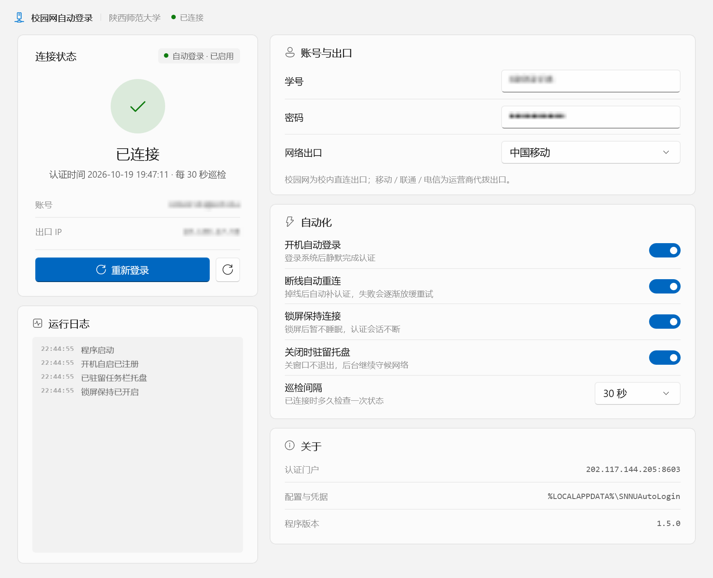
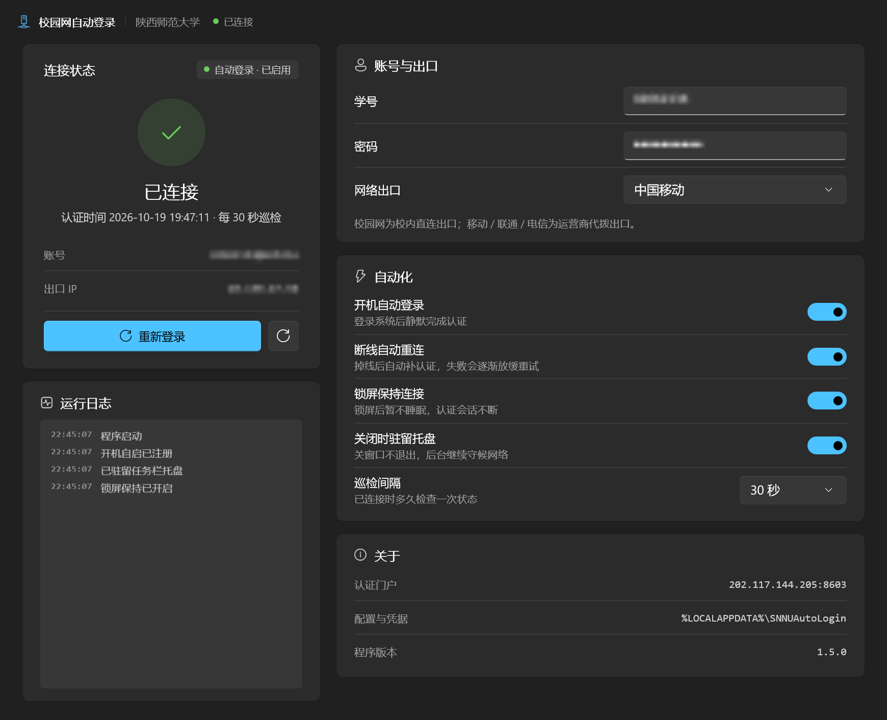
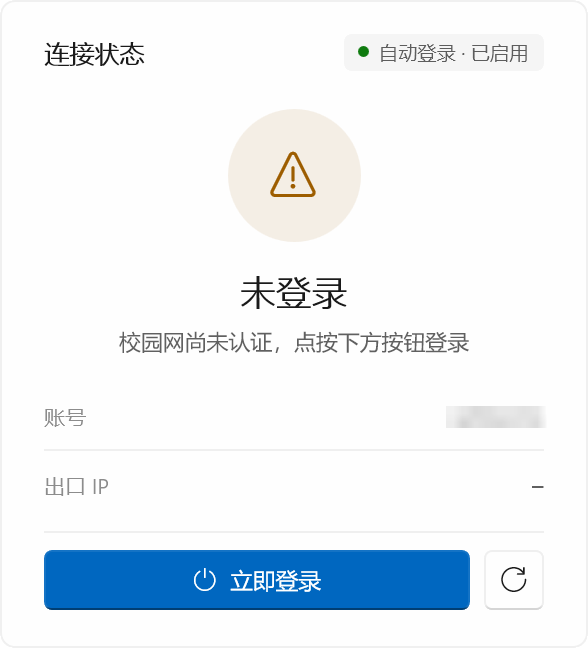
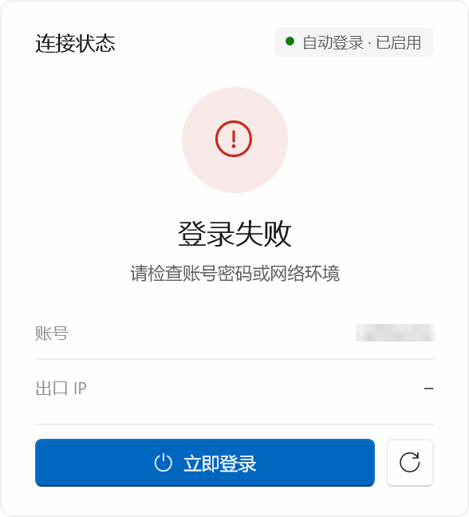
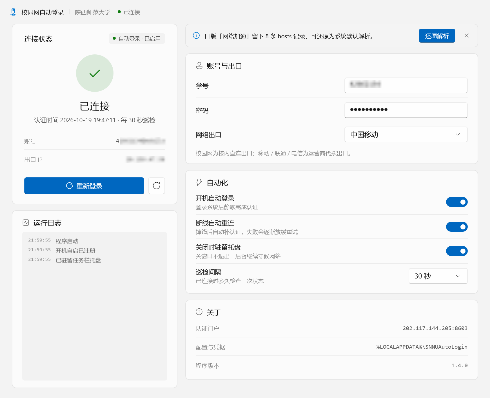

<p align="center">
  
</p>

<h1 align="center">SNNUAutoLogin-GUI</h1>

<p align="center">
  陕西师范大学校园网自动认证客户端 · 原生 WinUI 3 桌面程序
</p>

<p align="center">
  
  
  
  
  
</p>

<p align="center">
  
</p>

连上校园网就要手动打开浏览器、输账号、点登录，一天几次；断线了还得再来一遍。这个小工具把这件事接管了：**开机静默驻留托盘，检测到没认证就自动登录，掉线自动补上**，全程没有浏览器、没有 Electron，界面走系统原生的 WinUI 3。

> 非官方项目，与陕西师范大学及网络信息中心无关。仅用于个人设备接入校园网，请遵守学校网络使用规定。

## 特性

- **后台常驻，几乎不占资源** — 关窗口不退出，收进托盘继续守候。窗口可见约 43 MB，收进托盘约 19 MB，开机静默（`--tray`，从不创建窗口）约 9 MB
- **开机自动登录** — 开机后不弹窗，直接静默驻留托盘，检测出口未认证即提交账号
- **断线自动重连** — 已连接时按设定间隔巡检；Wi-Fi 重连、换网、休眠唤醒时**立即**补一次认证（监听 `NetworkChange`，1.5 秒去抖），不等下一轮
- **失败不硬敲** — 连续失败按 10 → 20 → 40 → 80 → 120 秒指数退避；没填账号、关掉自动重连、或不在校园网时放慢到 30~60 秒一次，不会每 3 秒去敲一次 Portal
- **锁屏也不掉线** — 锁屏后向系统申领「保持运行」：屏幕照常熄灭，但系统不进入睡眠，巡检与自动重连继续工作；解锁、从睡眠恢复时立刻补一次认证。不需要管理员、不装服务
- **出口可选** — 校园网直连 / 中国移动 / 中国联通 / 中国电信（对应 Portal 的 `yys` 参数）
- **密码本地加密** — Windows DPAPI（当前用户作用域）加密后落盘，磁盘上不是明文；程序不上传任何数据到第三方
- **系统原生观感** — Mica 背板 + 系统强调色 + Fluent 语义色，跟随系统深浅色与强调色实时变化；进场、状态切换、按压反馈都按 Windows 11「设置」的节奏与曲线做（300 ms 减速曲线、30 ms 错落），纯 Composition 实现，无第三方 UI 库
- **覆盖升级不丢配置** — 双击新版安装包即可，安装前自动结束托盘里的旧实例，账号密码与开关原样保留，自启路径自动纠正
- **完全自包含** — .NET 运行时、Windows App SDK、WinUI 全部随包，目标机不需要装 .NET、Windows App Runtime 或 VC++ 运行库

## 截图

| 深色模式 | 未登录 | 登录失败 |
| --- | --- | --- |
|  |  |  |

> 截图里的学号与出口 IP 已做模糊处理。

## 下载与安装

前往 [Releases](../../releases/latest) 下载最新安装包 `SNNUAutoLogin-Setup-1.5.1.exe`，双击按向导下一步即可（向导全中文）。

便携版下载 `SNNUAutoLogin-Portable-1.5.1-win-x64.zip`，**完整解压到固定目录**后运行 `SNNUAutoLogin.exe`，无需安装运行时。不要只复制 exe；其余 DLL 和资源必须保留。移动目录后手动运行一次，程序会把开机启动项更新到新位置。凭据仍按下文保存在当前用户的 LocalAppData 中。

| 项目 | 说明 |
| --- | --- |
| 安装位置 | 默认 `%LOCALAPPDATA%\Programs\SNNUAutoLogin`，**当前用户安装、不弹 UAC** |
| 为所有用户安装 | 向导首屏可切换，此时装进 `Program Files` 并请求管理员权限 |
| 快捷方式 | 开始菜单（程序 + 卸载），可选桌面快捷方式 |
| 卸载 | 设置 → 应用，或开始菜单「卸载 陕师大校园网自动登录」 |
| 系统要求 | 64 位 Windows 10 2004（19041）及以上 / Windows 11 |
| 安装包体积 | 32.3 MB（展开后约 128 MB） |

安装程序会做这几件事：

1. 检测到旧版本还在托盘驻留时先结束它（这一步早于版本检查，不会弹「请先关闭程序」）
2. 按 AppId 识别旧版本，覆盖升级时保留账号、密码与全部设置
3. 把开机自启项改指到安装目录（旧版本若是便携版，不会再启动那个旧路径）
4. 写入标准卸载信息，在「应用和功能」里正常显示名称、版本、发布者
5. 卸载时同时清除开机自启项与 `%LOCALAPPDATA%\SNNUAutoLogin` 下的凭据

### 覆盖更新

直接双击新版本安装包，**不需要先卸载**：

| 场景 | 行为 |
| --- | --- |
| 程序正在托盘驻留 | 安装前自动结束（约 0.1 秒），继续安装 |
| 账号、密码、开关 | 原样保留，不用重填 |
| 安装目录 | 沿用旧目录，不会装出两份 |
| 开机自启 | 路径自动指向新安装位置 |
| 静默升级（`/VERYSILENT`） | 若升级前程序在运行，装完自动拉起 |

> 安装包未做代码签名，首次运行可能被 Windows SmartScreen 拦一下，点「更多信息 → 仍要运行」即可。

## 使用

1. 从开始菜单启动
2. 填写**学号**（不需要带 `@mobile` 后缀，带了也能自动识别出口）与**密码**
3. 选择网络出口，点「立即登录」验证一次
4. 打开「开机自动登录」，完成

### 托盘

点右上角关闭按钮不会退出，而是收进通知区域（可在「自动化」里关掉「关闭时驻留托盘」恢复原行为）。

| 托盘菜单 | 说明 |
| --- | --- |
| 显示主窗口 | 双击图标等效 |
| 立即登录 | 不打开窗口直接发一次认证 |
| 开机自动登录 / 断线自动重连 / 关闭时驻留托盘 | 与界面开关同步 |
| 退出 | 真正结束进程 |

开机自启写入 `"...\SNNUAutoLogin.exe" --tray`，开机不弹窗，直接静默驻留。

开关变更立即写入当前用户的启动项，无需管理员权限；写入失败会记录日志并回退开关。首次运行会按保存的设置注册，目录移动或旧启动命令缺少 `--tray` 时会修复。Windows 登录用户后才会启动程序；若在任务管理器中禁用了此启动项，需要先手动重新启用。

「开机自动登录」与「断线自动重连」分别控制：开机登录在网络就绪后完成一次认证（失败按退避策略重试）；认证成功后是否继续自动补登录由自动重连开关控制。账号和密码需先填写保存。

### 图形验证码

Portal 有时候会要求输入图形验证码（连续快速重连、换了出口、或者学校开了风控都会触发）。
这时「账号与出口」卡片下方会展开验证码面板：图片加载出来、光标自动落到输入框，按回车或点「验证并登录」即可。
程序会自动识别登录页里的验证码字段名与图片地址（不写死选择器），提交时连同登录页上的隐藏域一起带上，
所以换接入点、换页面版本都不影响。看不清就点「换一张」。

窗口收在托盘时遇到验证码，程序会自动把窗口叫回来 —— 这一步必须有人看一眼，没法自动完成。

### 锁屏保持连接

笔记本合上盖子走开一会儿，回来发现已经掉线：多数情况不是校园网踢人，而是**系统进入睡眠**把网卡一起挂起了。
「自动化 → 锁屏保持连接」（默认开启）会在你锁屏时做两件事：

1. 向系统申领「保持运行」（`SetThreadExecutionState(ES_CONTINUOUS | ES_SYSTEM_REQUIRED)`）—— 屏幕该灭还是灭，但系统不会因为空闲进入睡眠，Wi-Fi 与认证会话因此不会断
2. 巡检照常跑：掉线立刻自动补认证；解锁、从睡眠恢复时再各补一次，避免正好卡在掉线的空档里

这里只用了一个线程持有系统请求，不写注册表、不装服务、不需要管理员，退出程序立刻撤销。可以随时用 `powercfg /requests`（需管理员）看到这条 `EXECUTION` 请求。

**它管不到的**：合上盖子（「关闭盖子时睡眠」是系统策略）、手动点睡眠、休眠、关机 —— 这些都是明确的用户意图，程序不会去对抗；Modern Standby 机型如果系统策略强制断网，也超出应用层能干预的范围。另外常驻不睡眠会略微增加耗电，插电使用或需要长时间挂着下载/远程连接时再打开最合适。

## 从 1.3.x 升级

1.4.0 起移除了「网络加速」。它只改本机域名解析，解决不了校园网对境外 IP 的单连接限速、也绕不过按 SNI 的阻断，留着更容易让人误以为「已经加速了」，所以整套功能连同它的测速、提权、日志一起下线。

旧版本写进系统 `hosts` 的那段标记块不会因为程序卸载就消失。升级后首次启动，界面顶部会出现一条提示：



点一下「还原解析」、在 UAC 弹窗里选「是」，就会把 `# >>> SNNUAutoLogin Accelerator >>>` 到 `# <<< SNNUAutoLogin Accelerator <<<` 之间的内容整段删掉 —— 按字节定位，块外内容一个字节都不动（包括别的工具写的中文注释，不会被转码破坏）。完成后提示条自动收起，此后不再出现；点右侧的 × 则本次运行不再提示。

不想走界面也可以手动还原：以管理员身份用记事本打开 `C:\Windows\System32\drivers\etc\hosts`，删掉那两行标记连同中间的内容，保存即可。

> 只有 1.3.0 ~ 1.3.3 装过、并且点过「立即优选」的机器才会看到这条提示；1.4.0 全新安装的机器没有这段 hosts。

## 隐私与数据

- 程序只会向学校 Portal（`202.117.144.205:8603`）提交账号、密码与出口类型，**没有遥测、没有第三方上报、没有联网检查更新**
- 密码用 Windows DPAPI 以当前用户密钥加密，只有同一台机器的同一账户能解开
- 设置与凭据都在本机，卸载时会一并删除

| 内容 | 路径 |
| --- | --- |
| 设置 | `%LOCALAPPDATA%\SNNUAutoLogin\settings.json` |
| 加密密码 | `%LOCALAPPDATA%\SNNUAutoLogin\secret.bin` |
| 开机自启 | `HKCU\Software\Microsoft\Windows\CurrentVersion\Run` → `SNNUAutoLogin` |

## 资源占用

界面与后台是彻底分开的两层：`AppRuntime`（凭据、巡检状态机、托盘、日志环形缓冲）与 `MainWindow`（纯视图）。窗口可以被完整拆掉再重建，后台不受影响。

1. 点关闭 → 先把界面上的值落盘，`Content = null` 丢弃整棵 XAML 树，并把 `x:Name` 生成的控件字段全部置空
2. 强制 GC（含大对象堆压缩）+ `EmptyWorkingSet`
3. 从托盘召回 → 复位 `_contentLoaded` 后重新 `InitializeComponent()`，按运行时状态回填设置、日志、连接状态
4. 开机自启带 `--tray`：一个窗口都不创建，只有托盘 + 巡检在跑

实测（1.5.0 正式版 / .NET 8 / Windows App SDK 1.8，x64，175% 缩放）：

| 场景 | 工作集 |
| --- | --- |
| 刚启动（窗口可见，尚未 Trim） | ~175 MB |
| 启动 6 秒后（首次自动 Trim） | **~20 MB** |
| 窗口可见（启动 6 秒后自动 Trim，静置） | **~43 MB** |
| 关窗收进托盘 | **~19 MB** |
| 召回窗口（重建内容树后立即测得） | ~68 MB，随后回落 |
| 私有提交 | ~115 MB（.NET + WinAppSDK 固定底子，Trim 动不了） |

> 任务管理器的「内存」列显示的是工作集。Trim 只换出物理页面、不释放提交内存，切回窗口时是毫秒级换页。
> 连做三轮「藏 ↔ 唤」测过：68.8 / 69.5 / 69.5 MB，私有提交 117.0 / 117.6 / 117.0 MB，没有累积。

## 工作原理

- **认证端点**：`http://202.117.144.205:8603/snnuportal/`
- **登录**：`POST application/x-www-form-urlencoded`，表单字段 `account` / `password` / `yys`（`mobile` / `unicom` / `telecom`），自动跟随 302
- **状态判定**：请求 `userstatus.jsp`，页面含「当前登录账号」即视为在线；页面是 GB2312，客户端按 GB18030 解码并做 UTF-8 回退
- **认证按出口 IP 绑定**：所以每次登录前先探测，已在线就直接跳过，不会重复提交
- **遇到图形验证码**：卡片里直接显示图片，输入后回车提交；识别失败自动换一张，窗口在托盘时会把窗口叫回来

## 构建

依赖：.NET 8 SDK、Windows App SDK 1.8（NuGet 自动还原）。

```bat
git clone https://github.com/<your-name>/SNNUAutoLogin-GUI.git
cd SNNUAutoLogin-GUI
dotnet build -c Debug -p:Platform=x64
```

发布便携版（自包含）：

运行 `powershell -File tools/build_portable.ps1` 会生成 `artifacts/SNNUAutoLogin-Portable-<版本>-win-x64.zip` 及 SHA256 校验文件。安装 Inno Setup 6 后运行 `powershell -File tools/build_release.ps1`，会用同一份自包含发布目录同时生成安装版 EXE、便携版 ZIP 和 `SHA256SUMS.txt`。GitHub Actions 的 Windows release build 会运行启动项、登录及凭据回归检查，验证安装、启动、卸载，再上传两种包。也可以只发布目录：

```bat
dotnet publish -c Release -r win-x64 -p:Platform=x64 --self-contained -o release
```

打安装包（需要 [Inno Setup 6](https://jrsoftware.org/isinfo.php)：`winget install JRSoftware.InnoSetup`）：

```bat
dotnet publish -c Release -r win-x64 -p:Platform=x64 --self-contained -o release
cd installer && build_installer.bat
```

产物：`installer\Output\SNNUAutoLogin-Setup-<版本>.exe`。

升级版本时改两处：`SNNUAutoLogin.csproj` 的 `<Version>` 与 `installer/SNNUAutoLogin.iss` 的 `#define AppVer`。
**`AppId` 一旦发布就不要改**，否则新版本会被当成另一个程序（无法覆盖升级、残留旧卸载项）。

### 自包含是怎么做到的

产物里 exe 内嵌了 946 条 `activatableClass` 清单（自包含部署的 WinRT 激活表），因此不需要目标机预装任何运行时：

```bat
python tools/check_deps.py release
```

逐个解析发布目录里 256 个 PE 文件的导入表，把依赖分成「随包 / 系统自带 / 缺失」三类。当前结论：所有非系统依赖都在发布目录内。

发布时还会剔除用不到的组件（Windows ML 的 `onnxruntime` + `DirectML` 约 39 MB、桌面小组件、.NET 崩溃转储、WebView2 运行时）与 84 个语言资源目录（只留 `zh-CN` / `en-us`），体积 210 MB → 128 MB，安装包 32.3 MB。`WinUIEdit.dll` 不能删 —— 它是 `TextBox` 的编辑内核，删掉后第一个输入框就创建不出来（踩过）。

1.4.1 起更进一步：发布后跑一遍全功能自检，用 `tasklist /m` 导出**运行期实际加载的模块清单**，与发布目录逐个比对，只删「从没被加载、也不在惰性加载路径上」的东西 —— 33 个程序集（`System.Private.Xml` 7.6 MB、`System.Data.Common`、`DataContractSerialization`、`Microsoft.VisualBasic.Core`、`Microsoft.CSharp`、`Microsoft.UI.Xaml.Phone` 等）、55 个 `.winmd` 元数据与 `workloads*.json`、`createdump.exe`、`RestartAgent.exe`、调试符号。这一刀砍掉 28 MB，代价是每次升级都得重跑一遍自检清单。

## 项目结构

```
├─ App.xaml(.cs)          应用入口，解析 --tray / --diag
├─ AppRuntime.cs          后台：凭据、巡检状态机、托盘、日志缓冲、网络监听
├─ MainWindow.xaml(.cs)   纯视图：状态卡片、账号设置、自动化开关、日志
├─ MainWindow.Dev.cs      开发期自检钩子（出图 / 托盘生命周期 / 内存下沉）
├─ MainWindow.UiTest.cs   下拉框逐项切换与命中测试
├─ Fx.cs                  Fluent 动效层（入场 / 文字交叉淡入 / 图标回弹 / 按压反馈）
├─ Services/
│  ├─ PortalClient.cs         Portal 协议：探测、登录、验证码、解码
│  ├─ LoginCoordinator.cs     巡检调度：间隔、退避、手动登录、立即唤醒
│  ├─ NetworkWatch.cs         网络事件监听 → 触发即时重连
│  ├─ CredentialStore.cs      设置读写 + DPAPI 加密密码（含内存缓存）
│  ├─ StartupManager.cs       开机自启注册与路径自愈
│  ├─ TrayIcon.cs             纯 Win32 Shell_NotifyIcon 托盘
│  ├─ WindowCloseHook.cs      子类化拦 WM_CLOSE，实现关窗转驻留
│  ├─ MemoryOptimizer.cs      GC + EmptyWorkingSet
│  ├─ HostsCleanup.cs         一次性清理旧版加速写入的 hosts 标记块
│  ├─ ThemeColors.cs          系统强调色与语义色跟随
│  └─ Diagnostics.cs          只读诊断输出
├─ installer/             Inno Setup 打包脚本 + 全中文语言文件
├─ tools/check_deps.py    PE 导入表解析，验证自包含
├─ tools/png_redact.py    README 截图的马赛克脱敏工具（纯标准库）
└─ docs/                  界面截图
```

## 排障

```bat
SNNUAutoLogin.exe --diag
```

只读检测 Portal 可达性与出口认证状态，结果写入 `%TEMP%\snnu_diag.txt`，不改动任何认证状态。
程序异常退出时，堆栈写到 `%TEMP%\snnu_crash.txt`。

开发期自检（发布版同样可用）：

| 参数 | 作用 |
| --- | --- |
| `--snapshot` | 整窗渲染到 `%TEMP%\snnu_shot.png`，几何与主题色写入 `snnu_geom.txt` |
| `--dark` | 配合 `--snapshot` 强制深色主题 |
| `--ui-test` | 下拉框逐项切换 + 命中测试 + 各状态出图 |
| `--motion` | 带动画地走「未登录 → 正在登录 → 已连接」，逐段出图并检查文字没被动画卡在透明态 |
| `--lock-test` | 模拟锁屏 / 解锁（走与真实 WTS 通知相同的处理路径），检查「保持运行」是否按开关正确申领与撤销，报告写入 `%TEMP%\snnu_lock.txt` |
| `--test-close` | 模拟点关闭 → 应转驻留托盘（释放内容树）→ 再召回重建 |
| `--test-tray` | 连做 3 轮「藏 ↔ 唤」，输出每轮内存与重建后控件状态 |
| `--test-exit` | 在托盘驻留状态下退出，验证进程真结束、无残留图标 |
| `--op=N` | 强制指定出口（0 校园网 / 1 移动 / 2 联通 / 3 电信） |
| `--login-selftest` | 拿三份典型 Portal 页面跑登录页解析（离线），结果写入 `%TEMP%\snnu_login_selftest.txt` |
| `--captcha-demo` | 塞一张假验证码进状态机，检查验证码面板的布局与交互（配合 `--snapshot` 出图） |
| `--hosts-selftest <报告路径>` | 只算不写：输出「删掉旧标记块之后 hosts 应该是什么样」，并落到 `<hosts>.cleaned` |

环境变量 `SNNU_HOSTS_PATH` 可把 hosts 换成一份副本，用来在没有管理员权限的情况下验证清理逻辑（只影响本程序，系统 hosts 不动）。

## 常见问题

**会把我的账号密码传到别处吗？**
不会。只有一个目的地：学校 Portal。密码加密存在本机，代码全部开源可查。

**为什么点关闭程序还在？**
设计如此：关窗只是收进托盘，这样断线时才能自动重连。不想要就到「自动化」里关掉「关闭时驻留托盘」，或托盘右键退出。

**不在校园网（家里宽带 / 手机热点）会怎样？**
Portal 探测失败，巡检自动放慢到最多 60 秒一次，不会刷请求；回到校园网后靠网络事件监听立即接管。

**提示需要图形验证码？**
Portal 偶发要求验证码（连续快速重连、换出口、学校开风控都会触发），卡片里会直接显示图片，照着输入回车即可；看不清点「换一张」。程序不做验证码识别，也不需要你打开浏览器。

**Windows 10 能用吗？**
能。Mica 背板只在 Windows 11 生效，Win10 上自动退化为纯色背景，功能不受影响。

**托盘图标不见了？**
Windows 会把不常用图标折叠进「^」溢出区，拖出来固定一下即可。

## 更新记录

各版本的安装包都在 [Releases](../../releases) 页面按版本号归档，可以直接下载对应版本，不需要逐级升级。

### 1.5.1

合并社区贡献的 PR（[@marike86](https://github.com/marike86)），修复开机自启与凭据保存两部分的问题：

- **开机自启**：此前只在首次运行时尝试写入一次注册表，写入失败不做提示，开关仍显示为开启。现在每次启动都会按配置同步 `HKCU\Run`，失败时把开关恢复为关闭并记录日志。便携版移动目录后旧启动项会被误认为有效，原因是只比较了命令行中是否包含可执行文件名，现在改为按完整命令行比较，缺少 `--tray` 的旧命令也会被改写。主窗口与托盘共用同一套写入和校验逻辑
- **开机自动登录**：不再依赖「断线自动重连」开关。以 `--tray` 启动后，网络就绪时先完成一次认证，失败按原有退避策略重试；认证成功之后是否继续补登录仍由重连开关决定
- **账号与密码保存**：此前写入失败时内存缓存仍被标记为已保存，后续不再重试。现在保存结果会返回给调用方并写入日志，配置文件和密码都改为先写临时文件再替换，中途失败不会截断原文件
- 配置文件内容异常时回落到默认值，包括空账号、无效的网络出口类型和超出范围的巡检间隔
- 托盘注册失败时保留可访问的窗口，已有实例运行时不会因开机项重复拉起而弹出主窗口
- 新增 `tests/StartupTests`、`tests/CredentialTests` 两套回归测试，`tools/build_release.ps1` 用同一份发布目录生成安装版与便携版，GitHub Actions 上运行测试并验证安装、启动与卸载

### 1.5.0

- **新增「锁屏保持连接」**（默认开启）：锁屏时向系统申领 `ES_SYSTEM_REQUIRED`，屏幕照常熄灭但系统不进入空闲睡眠，Wi-Fi 与 Portal 会话不断；巡检与自动重连照常工作，解锁 / 睡眠恢复时再各补一次认证
- 锁屏监听用独立线程上的隐藏窗口接 `WTS` 会话通知，因此 `--tray` 开机静默模式（从不创建窗口）同样有效；不写注册表、不装服务、不需要管理员
- 锁屏期间如果需要验证码，不再把窗口从托盘召回（锁屏时也看不见），等解锁后再弹出来
- 开关关掉立即撤销「保持运行」，不必等到解锁或下次启动

### 1.4.1

- **体积再砍一刀**：安装包 40.8 → **32.3 MB**，展开 156 → **128 MB**
  - 按「运行期实际加载的模块清单」比对发布目录，删掉 33 个从没被加载的程序集（含 7.6 MB 的 `System.Private.Xml`）、55 个 `.winmd` 元数据、`workloads*.json`、`createdump.exe`、`RestartAgent.exe` 与调试符号
  - 覆盖安装会先递归删掉安装目录里的旧文件（保留卸载器），老用户升级后 162 → 134 MB，不会再带一堆新版本已经不带的东西
- **内存**
  - 启动后的首次 Trim 从 20 秒提前到 **6 秒**，任务管理器里不再长时间挂着 170MB
  - 运行时开启 `System.GC.ConserveMemory=7`，托管堆按需增长、不再预留
  - 说明一下天花板：WinUI 把 XAML 内容树整棵丢掉后私有提交仍然是 ~114 MB，这部分是 Windows App SDK 的固定底子，Trim、GC、删控件都动不了
- **流畅度**
  - 日志改成**按帧合并**：90 ms 内的多条日志一次性插入，不再每来一条就重排一次列表 + 播放过渡动画
  - 窗口首帧先画出来，巡检线程 / 网络事件订阅 / 托盘状态写入推迟到下一轮低优先级 —— 启动观感快一拍
  - 分层 PGO（`TieredPGO`）打开，热路径跑几轮后自动优化

### 1.4.0

- **移除「网络加速」**，回到一个纯粹的校园网登录工具：测速、优选、`hosts` 写入、UAC 提权子进程、`accel.log` 全部下线。这个功能解决不了校园网对境外 IP 的限速和按 SNI 的阻断，留着只会让人误以为已经加速了
- **一键还原旧版残留**：检测到 1.3.x 写进系统 `hosts` 的标记块时，界面顶部出现一条提示，点「还原解析」即可清除（按字节定位，块外内容逐字节保留）。判定与写入逻辑有 `--hosts-selftest` 可离线自检
- **界面重做，动效对齐 Windows 11 设置**
  - 统一动效 token：300 ms 减速曲线（`cubic-bezier(0.10, 0.90, 0.20, 1.00)`），卡片入场间隔 30 ms，整套进场 400 ms 内完成
  - 状态切换改成**交叉淡入**：先 80 ms 淡出、换字、再淡入上移，不再"硬切一下"
  - 状态图标切换时轻微回弹（0.9 → 1，带过冲），忙碌时只留系统进度环
  - 验证码面板改为淡入展开、淡出收起，不再瞬间顶开布局
  - 按下反馈扩到刷新按钮；日志项保留 `AddDeleteThemeTransition`
- **体积**：安装包 42.4 → **40.8 MB**，展开 160 → 156 MB
  - 发布时剔除 84 个用不到的语言资源目录（只留 `zh-CN` / `en-us`）与 `NpuDetect`
  - 安装包压缩从 `lzma2/max` 提到 `lzma2/ultra64`
  - 覆盖安装会主动清理旧版本遗留的目录（Inno 的 `[Files]` 只覆盖同名文件，不删多余目录，否则升级完体积不会变小）
  - 注：WinUI 3 自包含有硬底子 —— .NET 运行时 + WinUI 原生 DLL + Windows SDK 投影三块就占了 85%，再往下只能砍功能或改成依赖系统运行时
- **后台占用**
  - 关窗回收从"两轮 GC + 再调一次 Trim（内部又是两轮 GC）"合并成一次，藏窗口时不再白卡一下
  - `NetworkWatch` 复用同一个去抖定时器，不再每次网络变化都新建一个
  - 关闭并发 GC（`ConcurrentGarbageCollection=false`），少一条后台线程，对这么小的堆暂停时间可忽略
  - 托盘驻留实测 ~19 MB（此前 ~17 MB，差异在测量时机），窗口召回后不再累积

### 1.3.3

- **改变选路标准：从"谁握手快"改成"谁下得动"**
  - 老逻辑按 TCP 握手延迟排序，实测会稳定选到慢节点：同一批 GitHub 出口里，握手 0.19s 的只有 9KB/s，握手 0.6s 的反而 47KB/s
  - 现在多一步真实下载测速（每节点抓 40KB，按字节/秒计），证书校验和测速放在同一条连接上完成
  - 效果：`github.com` 首页单连接从 ~25KB/s 提到 46~100KB/s，静态资源站 `github.githubassets.com` 到 130KB/s
- **不再把"阻断"写成"已加速"**：TLS 一握手就被重置的域名（当前网络下是 `raw.githubusercontent.com`、`steamcommunity.com`）会被跳过，卡片上单独标"N 个被阻断"。这类域名 hosts 改不了，是链路按 SNI 切断的
- **平台行显示实测速度**：`已加速 5/8 · 实测 62 KB/s`，比原来的"均值 90 ms"更能说明实际体验
- **探测更克制**：并发闸门 6、每域名最多验 5 个候选、失败只补一次。之前 17×6 个候选一起握手会瞬间建立上百条连接，既测不准（互相抢带宽），也容易触发校园网的异常流量阈值
- 失败时不再把旧条目留在 hosts 里：本次没选出来的域名会从标记块里移除，回落到系统解析

> **能力边界**（重要）：hosts 方案只能解决"解析被污染"和"选到较慢节点"两件事。
> 校园网对境外 IP 的单条连接限速（实测约 28KB/s）和按域名的 SNI 重置，都不是改 DNS 能解决的。
> 如果某个域名在当前网络下被整体切断（实测 `github.com` 会间歇性出现所有候选 IP 都握手超时），
> 程序只会照实报"被阻断"，不会假装成功。

### 1.3.2

- **新增图形验证码**：Portal 要求验证码时，卡片里直接显示验证码图片，输入后回车即可登录；支持「换一张」
  - 登录页解析不依赖固定模板：自动识别表单 `action`、隐藏域（NAS 参数）、验证码字段名（`checkcode` / `randcode` / `vcode` …）与图片地址
  - 提交时把隐藏域原样带上，接入点参数不会再丢
  - 验证码错误会自动换一张并给出提示；窗口在托盘时会自动召回
- **修掉「加速节点全部不通」的误报**：17 个域名全灭时不再只说「所有节点均未通过校验」，而是先诊断一层网络（Portal 可达？外网可达？）再给出原因 —— 没认证、不在校园网、还是真被拦
- **解析绕开 hosts**：改用 `dnsapi!DnsQuery`（`DNS_QUERY_NO_HOSTS_FILE`）取真实 A 记录。以前优选过一轮之后，`Dns.GetHostAddresses` 读到的其实是程序自己写进 hosts 的 IP，导致「原始 IP == 上次选的 IP」，既判断不出是否更快，也回不到真实 DNS 结果
- 登录页里混着的 CNAME / 权威段记录会被过滤，候选 IP 不再掺进 gTLD 服务器地址

### 1.3.1

- **修掉「点立即优选没反应」**：加速服务在后台线程直接往界面日志列表里写记录，跨线程操作 `ObservableCollection` 抛异常后被吞掉，整段优选在第一步就中止 —— 既没写 `hosts`，界面上也没有任何提示。现在日志统一回到 UI 线程派发，且日志出错不会再影响优选结果
- **加速卡片有实时反馈**：进度条 + 状态行跟着「测速 8/17 → 等待管理员授权 → 写入解析 → 已写入 15 条」走，结束后无论成败都留一句结果在卡片里（成功绿、需注意黄、失败红）
- **UAC 那一步会明说**：卡片提示「等待管理员授权：请在系统弹窗中点『是』」，弹窗被挡住也不会再以为程序卡住
- **测速更快**：前 3 名节点的 TLS 校验从串行改成并发，域名并发数 5 → 8，17 个域名实测从约 20–40 秒降到 5 秒内
- **新增 `%LOCALAPPDATA%\SNNUAutoLogin\accel.log`**：记录每次优选的测速结果、UAC 请求与写入退出码，反馈问题时可直接取证
- 三个平台行会显示「已加速 7/8 · 均值 90 ms」这类实际进度，按钮在已生效时变成「重新优选」

### 1.3.0

- **新增网络加速**：GitHub / Steam / Epic 三个平台各自开关，一键对本机域名做测速优选并写入 `hosts`
  - 候选节点 = 系统 DNS 结果 + 内置备用池，TCP 443 并发测速，延迟最低的前 3 个再做带 SNI 的 TLS 校验，证书不匹配一律丢弃（挡掉 DNS 劫持）
  - 不可达的域名原样跳过；写入后用 `DnsFlushResolverCache` 刷缓存
  - 只写一段带起止标记的块，块外内容逐字保留；「还原解析」一键清除
  - 日志会说明本次真正替换了多少个域名，避免「点了没反应」的误解
- **自建 `Program.Main`**（`DISABLE_XAML_GENERATED_MAIN`）：提权写 hosts 的子进程完全跳过 WinUI 初始化，耗时从约 1 秒降到 0.34 秒，且不会闪窗口
- **新增 `--accel-probe`**：只读跑一遍优选并输出报告（含将要写入的 hosts 预览），用于判断「是节点不行还是授权不行」
- **窗口默认高度 760 → 840**，右栏设置项少滚动一屏
- 加速卡片超出可视区时随右栏 `ScrollViewer` 滚动，不挤压其他卡片

### 1.2.0

- **巡检不再空转**：没填账号、关掉自动重连时由每 3 秒一次放慢到 30 秒一次，并在日志里说明原因（同一原因只记一条）
- **失败指数退避**：10 → 20 → 40 → 80 → 120 秒封顶；Portal 不可达最多 60 秒一次
- **网络恢复即重连**：新增 `NetworkWatch`，连上 Wi-Fi、换网、唤醒后立刻补一次认证
- **少做无用功**：密码改为内存缓存（原来每轮巡检都做一次 DPAPI 解密 + 读盘）；设置与密码内容没变就不写盘；手动刷新不再和后台巡检抢锁
- **修掉的小问题**：关于页版本号改为读程序集（原来写死 `1.0.0`）；学号/密码为空时点登录直接聚焦输入框
- **安装包**：安装前结束托盘实例（`InitializeSetup` 早于 AppMutex 检查），静默升级后自动拉起，自启路径自动纠正

### 1.1.0

首个安装包：用户级安装（免 UAC）、全中文向导、覆盖升级保留配置、卸载清理干净。

## 致谢

界面规范参考 Windows 11 系统应用；托盘与关窗拦截走纯 Win32（WinUI 3 的 `AppWindow.Closing` 在程序内 `Close()` 时不触发，只能子类化拦 `WM_CLOSE`）。

---

> 本项目仅面向陕西师范大学校园网 Portal 的认证流程。其他学校 Portal 的字段与判定逻辑不同，需要自行改写 `Services/PortalClient.cs`。
