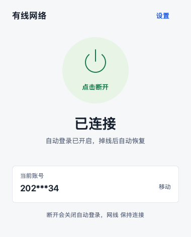

<picture>
  <source media="(prefers-color-scheme: dark)" srcset="docs/assets/hero-dark.svg">
  
</picture>

<strong>连接学校网络，剩下的交给它。</strong>

一次保存账号，自动登录、掉线重连。专为陕西师范大学校园网制作。

  
  
  

<a href="#下载">下载安装</a> · <a href="#界面预览">界面预览</a> · <a href="#体积与内存">体积与内存</a> · <a href="#开始使用">使用指南</a> · <a href="https://github.com/shixiang-liu/SNNU-AutoLogin/issues">反馈问题</a>

## 下载

| 平台 | 应用版本 | 系统要求 | 安装包 |
| :--- | :--- | :--- | :--- |
| **Windows** | v1.0.1 | Windows 10 / 11 · x64 | [免安装 ZIP](https://github.com/shixiang-liu/SNNU-AutoLogin/releases/download/v1.0.1/SNNU-AutoLogin-v1.0.1-windows-x64.zip) · [单文件 EXE](https://github.com/shixiang-liu/SNNU-AutoLogin/releases/download/v1.0.1/SNNU-AutoLogin.exe) |
| **macOS** | v1.0.0 | macOS 13+ · M 系列 / Intel | [M 系列芯片](https://github.com/shixiang-liu/SNNU-AutoLogin/releases/download/macos-v1.0.0/SNNU-AutoLogin-v1.0.0-macos-arm64.zip) · [Intel 芯片](https://github.com/shixiang-liu/SNNU-AutoLogin/releases/download/macos-v1.0.0/SNNU-AutoLogin-v1.0.0-macos-x64.zip) |
| **Android** | v1.0.0 | Android 8.0 及以上 | [安装 APK](https://github.com/shixiang-liu/SNNU-AutoLogin/releases/download/android-v1.0.0/SNNU-AutoLogin-android.apk) |

[查看更新记录](https://github.com/shixiang-liu/SNNU-AutoLogin/releases) · [Mac 首次打开说明](docs/macos.md#第一次使用)

## 界面预览

| Windows | macOS | Android |
| :---: | :---: | :---: |
|  |  |  |
| [查看设置界面](docs/screenshots/settings.png) | [查看 Mac 界面](docs/macos.md#界面预览) | [查看 Android 界面](android/README.md#界面预览) |

## 日常少操心

<table>
<tr>
<td width="50%" valign="top"><strong>一次设置，自动登录</strong> 保存账号和上网方式，连上学校网络后自动认证，省去反复打开网页。</td>
<td width="50%" valign="top"><strong>掉线之后，尝试恢复</strong> 检查网络变化并自动重连；遇到账号问题时暂缓重试。</td>
</tr>
<tr>
<td valign="top"><strong>原生界面，后台运行</strong> 桌面端在托盘或菜单栏运行，安卓端通过通知栏快捷操作。</td>
<td valign="top"><strong>密码加密，留在本机</strong> 账号只用于学校认证，不经过开发者服务器；没有广告或统计 SDK。</td>
</tr>
</table>

支持学校认证页中的「校园网」「移动」「联通」三种上网方式。工具只负责认证，不会替你切换 Wi-Fi。

## 体积与内存

| 平台 | 程序体积 | 后台实测占用 | 测量环境 |
| :--- | :--- | :--- | :--- |
| **Windows** | 约 1 MB · EXE | 约 **14 MiB** 工作集 | Windows 11 x64 · v1.0.0 历史基线 |
| **macOS · M 系列** | **1.21 MiB** · App | **13.39 MiB** 物理占用 | macOS 15.7.9 · arm64 云端 |
| **macOS · Intel** | **1.25 MiB** · App | **9.70 MiB** 物理占用 | macOS 15.7.9 · x86_64 云端 |
| **Android** | **55.2 KiB** · APK | **23.9 MiB** PSS | 一加 11 · Android 16 |

各系统的内存统计口径不同，以上是对应测试环境的记录，不作直接排名。[测量方法、前台占用与原始记录 →](docs/performance.md)

## 开始使用

1. 下载对应安装包，连接学校 Wi-Fi 或有线网络。
2. 填写学号、校园网密码和上网方式，点击「保存并连接」。
3. 保持自动登录开启，之后可关闭界面，让工具在后台工作。

| 平台说明 | 按需查看 |
| :--- | :--- |
| **macOS** | [安装、系统权限与菜单栏操作](docs/macos.md) |
| **Android** | [安装、通知与后台设置](android/README.md) |
| **开发者** | [从源码构建](docs/building.md) · [版本与分支约定](CONTRIBUTING.md) |

Windows 免安装，解压即可使用。Mac 首次打开可能需要在系统设置中允许运行；Android 如需锁屏后持续重连，请检查「后台与通知」设置。

## 反馈与隐私

遇到问题可提交 [GitHub Issue](https://github.com/shixiang-liu/SNNU-AutoLogin/issues)，或通过 [邮件](mailto:shixiang.liu@foxmail.com) 联系。请说明系统版本、客户端版本和复现步骤，也可以附脱敏诊断报告。

账号保存与报告分享说明

账号密码保存在本机，各客户端需要分别填写。学校认证门户使用 HTTP，本机加密保存不代表网络传输加密。

诊断报告会隐藏账号、不包含密码；分享前仍请检查 IP、路径等个人信息，不要上传完整配置。

---

[MIT 开源](LICENSE) · 面向陕西师范大学校园网的社区工具，与学校官方客户端无隶属关系。
